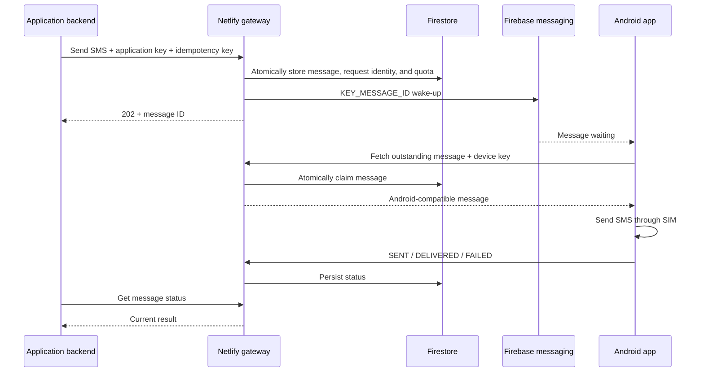

# SMS gateway — Netlify milestone 1

A lightweight, self-hosted API based on [NdoleStudio/httpSMS](https://github.com/NdoleStudio/httpsms). Application backends submit SMS notifications to Netlify. Firestore stores each request, Firebase Cloud Messaging wakes the Android phone, and the phone sends the SMS through its SIM and reports its result.

This milestone provides application/device API keys, durable acceptance, application-scoped idempotency, rate limits, expiry, bounded wake-up recovery, and message status. Dashboard, public signup, incoming SMS, MMS, campaigns, and multiple-phone routing are deferred.

**Every file in `android/` is unchanged from upstream.** The upstream Go API, web app, and original tests are retained as references. Netlify builds only the new TypeScript gateway. See [original documentation](docs/UPSTREAM_README.md), [provenance](docs/UPSTREAM.md), and [Android contracts](docs/ANDROID_CONTRACT.md).

## Flow



## Firebase and Android prerequisite

The backend service account must be authorized for the Firebase project configured in the installed APK. Changing the app's server URL changes its HTTP endpoint, not its Firebase project.

The official downloaded APK uses upstream's Firebase configuration. Your own Firebase project cannot wake that APK. For independent self-hosting, upstream documents building an APK with your own `google-services.json`; this changes build configuration rather than Android application logic. This repository leaves even that configuration file untouched. Use an existing APK configured for your Firebase project or arrange that separate build before testing on a phone.

The phone needs Google Play Services, internet, an active SIM, SMS permissions, and permission to run in the background. This milestone provisions one phone number and one SIM (`SIM1` by default). Use one active SIM for the first test.

## Checks and local development

Use Node.js 22 or newer:

```sh
npm ci
npm run check
```

The tests cover the HTTP lifecycle, Android model fields, access boundaries, concurrent duplicate requests/fetches, recovery, expiry, quotas, and callback races. Firebase transport is simulated; no automated test sends a real SMS. The build typechecks and compiles both Netlify entry points.

Run the real Firestore integration suite with a Firebase CLI and Java version supported by that CLI:

```sh
firebase emulators:exec --only firestore --project demo-sms-gateway 'npm run test:firestore'
```

The suite uses isolated collections and deletes its own data. It skips without `FIRESTORE_EMULATOR_HOST`. The emulator does not enforce production composite-index requirements; deploy the supplied index before production use.

`npm run dev` serves the handler on `http://127.0.0.1:8888`. For database-backed development, configure Firebase as below. For isolated emulation, set `FIREBASE_PROJECT_ID=demo-sms-gateway`, `FIRESTORE_EMULATOR_HOST=127.0.0.1:8080`, and `GATEWAY_MOCK_PUSH=true` while the emulator runs. Mock wake-ups log only message IDs. These settings are rejected on Netlify. Local development does not run recovery sweeps; Netlify schedules them in production. Android's login requires HTTPS, so a local HTTP URL alone cannot be used on the phone.

## Configure Firebase

1. Use a dedicated Firebase project with a Standard/native Firestore database and Firebase Cloud Messaging enabled.
2. Obtain a service account with permission to read/write Firestore and send FCM messages in the project configured in your Android APK.
3. Copy `.env.example` to `.env`. Set `FIREBASE_PROJECT_ID` and the service account JSON as `FIREBASE_CREDENTIALS`. Locally, `GOOGLE_APPLICATION_CREDENTIALS` can point to a private JSON file instead.
4. Deploy rules and the recovery-query index:

```sh
firebase deploy --only firestore:rules,firestore:indexes --project YOUR_PROJECT_ID
```

The supplied rules deny direct client access to every collection; privileged server access uses IAM. Apply these rules to a dedicated database. If you change `GATEWAY_COLLECTION_PREFIX`, also update `collectionGroup` in `firestore.indexes.json`.

This gateway does not require upstream Firebase Authentication, SMTP, Redis, or Turnstile services.

## Provision credentials

With Firebase configured:

```sh
npm run provision -- --app notifications --phone +639171234567
```

The script creates application/device registrations and saves their generated keys privately to `gateway-credentials-notifications.json` with mode `0600`. Git ignores that file. Firestore stores only SHA-256 key hashes. Keys are never printed; keep the file secure.

To add an application sharing the registered phone:

```sh
npm run provision -- --app another-app --device primary-phone
```

Use the original device key on the phone. The second registration generates only an application key. Provisioning refuses to overwrite existing application registrations or credential files. If a remote write fails after a file is created, retain the file and inspect Firestore before retrying: the remote commit may have completed.

Disable a key by setting its key document's `active` field to `false`. Disabling an application/device document also blocks its operations. Administration UI and key rotation are deferred.

| Setting | Default | Purpose |
| --- | --- | --- |
| Application quota | 10/minute | New accepted requests for each application |
| Device quota | 3/minute | Message handoffs across all applications sharing the phone |
| Message lifetime | 300 seconds | Expire messages the phone has not claimed |
| Wake-up interval | 60 seconds | Retry pending wake-ups |
| Wake-up attempt limit | 5 | Bound FCM attempts per message |
| Recovery batch | 5 | Bound each scheduled invocation |

Use provisioning's `--app-limit` and `--device-limit` for quotas; environment settings are listed in `.env.example`. Traffic exceeding phone capacity can expire while queued.

## Deploy to Netlify

1. Publish your fork with this gateway's corresponding source and retained license/attribution. Set `SOURCE_CODE_URL` to that fork; API responses then include a source link.
2. Connect the fork to Netlify. The root `netlify.toml` defines the build, functions, publish directory, and Node.js 22.
3. Set `FIREBASE_PROJECT_ID`, `FIREBASE_CREDENTIALS`, and `SOURCE_CODE_URL` in Netlify environment variables. Give credentials the **Functions** scope. Do not expose them to frontend code or commit them.
4. Never enable emulator/mock settings on Netlify. Previews must use a separate Firebase project and phone, or leave credentials unset.
5. Deploy and open `GET /health`. This verifies liveness, not Firebase/phone readiness. The `api` function serves `/v1/*` and `/health`; `dispatch-pending` runs every minute on published production deployments. Scheduled sweeps do not run on previews.
6. In the Android app's existing login screen, enter the Netlify HTTPS origin **without a trailing slash or `/v1`**, the device API key, and the provisioned phone number/SIM. Its existing registration request stores its FCM token.

## Application API

Call from your application's backend; keep the application key off the browser/mobile frontend:

```sh
curl "$SMS_GATEWAY_URL/v1/messages/send" \
  -H "x-api-key: $SMS_GATEWAY_APP_KEY" \
  -H 'Content-Type: application/json' \
  -H 'Idempotency-Key: order-ready-123' \
  --data '{"to":"+639189876543","content":"Your order is ready."}'
```

`to` uses international E.164 format; text contains 1–1600 characters. Longer text can use multiple SMS segments. The gateway selects the application's assigned sender; optional `from` must match it. Attachments and encryption are rejected in this milestone.

Supply `Idempotency-Key` or a JSON `request_id`; if both are supplied they must match. Retry with the same key and payload. Matching retries return the same ID; changed payloads return `409`. Keys are scoped to each application.

Successful acceptance returns `202`, an httpSMS envelope `{status,message,data}`, a `Location` status URL, and `Idempotency-Replayed: true|false`. `data` contains the message ID and Android-compatible fields. Acceptance confirms storage, not physical sending. Read the latest status:

```sh
curl "$SMS_GATEWAY_URL/v1/messages/MESSAGE_UUID" \
  -H "x-api-key: $SMS_GATEWAY_APP_KEY"
```

| Status | Meaning |
| --- | --- |
| `pending` | Stored, waiting for the phone |
| `sending` | Claimed by the phone; the send outcome can still be unknown |
| `sent` | Android reported a successful send |
| `delivered` | Android reported a carrier delivery result |
| `failed` | Phone failure or a permanent Firebase registration error |
| `expired` | Lifetime elapsed before the phone claimed the message |

Delivery reports depend on the carrier. Applications can read only their own messages. Device keys cannot submit messages; application keys cannot claim messages or report phone events.

## Recovery and delivery boundaries

Acceptance, request identity, and the application quota commit atomically. The API awaits an immediate FCM attempt; a bounded, indexed recovery sweep handles pending work after transient failures or interrupted requests. FCM carries only a UUID, never SMS contents. The phone fetches contents over authenticated HTTPS.

Fetching atomically changes `pending` to `sending`; concurrent/repeated fetches return `404` after the first handoff. Phone-quota rejections leave the message pending for a later wake-up. Only unclaimed messages are retried or expired.

**Exactly-once physical SMS delivery is not guaranteed.** The unchanged phone cannot distinguish a lost fetch response from a send whose acknowledgment was lost. Claimed messages remain `sending` until reported, and are never automatically requeued. Inspect the phone before intentionally creating a new request for an ambiguous message. Reported SMS failures are not automatically resent.

Duplicate/out-of-order events preserve delivery: `delivered` cannot regress to `sent`/`failed`. Android's explicit `CANNOT BE DELIVERED` event can mark an already-sent SMS failed; a late duplicate `SENT` cannot erase that delivery failure. Intermediate multipart callbacks are ignored like upstream; the final unsuffixed callback determines status. Inbound SMS/missed-call requests return `410`, which the existing Android workers treat as finished, without storing their contents.

Gateway logs exclude keys, FCM tokens, phone numbers, and message contents. Messages and idempotency records are retained until explicitly deleted; choose a retention policy before broader production use. Retain request identities for at least as long as clients might retry.

## Physical-phone acceptance test

After deployment, matching Firebase configuration, and device registration:

1. Send a unique short notification to a phone you control; verify `202`, receipt, and `sent` status.
2. Verify `delivered` if the carrier provides a report.
3. Repeat the request/key; verify the same ID and no additional SMS.
4. Verify another application's key cannot read that message.
5. Disconnect the sending phone's internet, queue a message, reconnect before expiry, and verify recovery.
6. Leave a request unclaimed past its lifetime and verify `expired`.

These checks require real credentials and hardware; automated verification simulates the phone and transport.

## License

The repository retains upstream's [AGPL-3.0 license](LICENSE). The new gateway uses the same license. Publish the corresponding source for your deployed modified service, preserve notices, and set `SOURCE_CODE_URL` to your fork. Keep credentials and private message data out of source publication.
